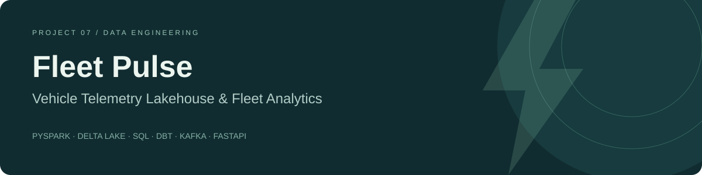
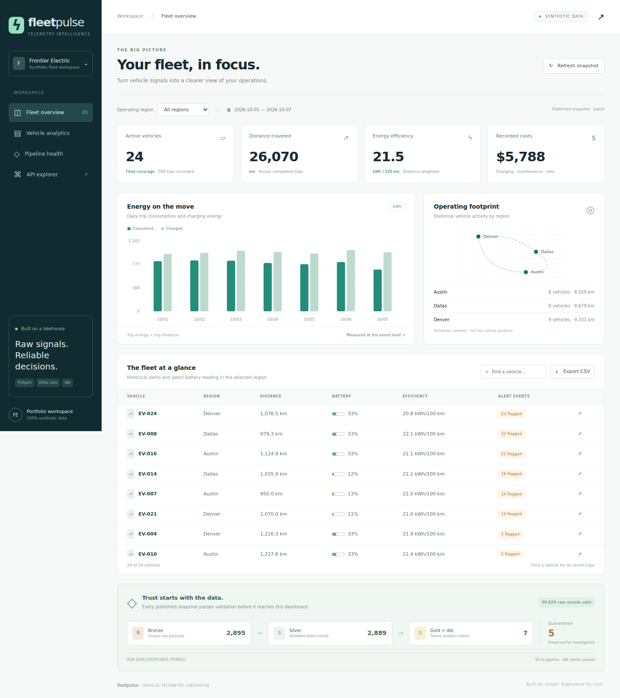
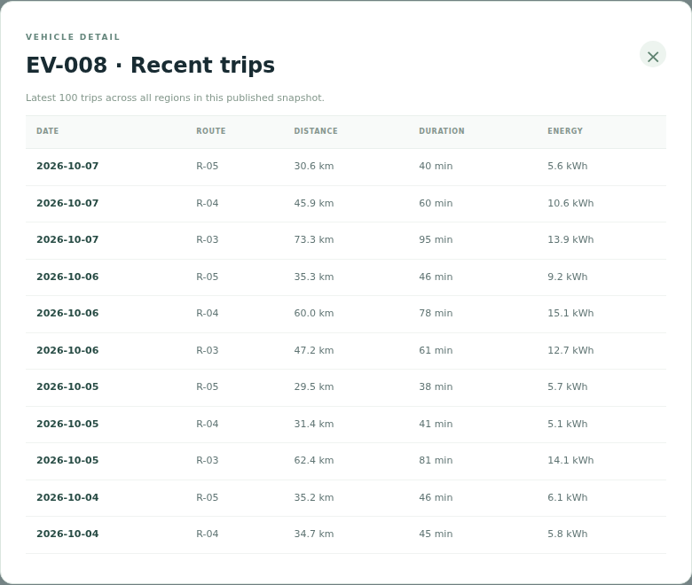
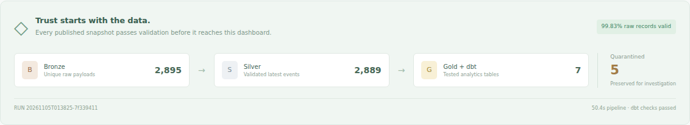
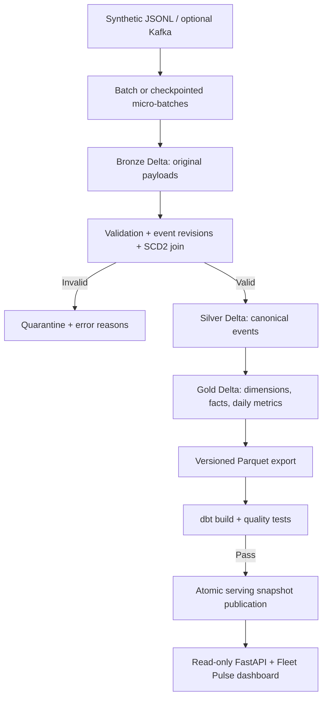

# Vehicle Telemetry Lakehouse & Fleet Analytics

[](https://github.com/krishna-theja-nooka/vehicle-telemetry-lakehouse/actions/workflows/ci.yml)
[](https://github.com/krishna-theja-nooka/vehicle-telemetry-lakehouse/stargazers)


**Fleet Pulse** turns synthetic electric-vehicle signals into validated, traceable fleet analytics. A working local data engineering project with real **PySpark transformations, Delta transaction logs, checkpointed Structured Streaming, SCD Type 2 joins, dbt tests, and a responsive dashboard**.

Built to demonstrate automotive data engineering and customer-facing analytics. All companies, vehicles, locations, routes, events, and operational outcomes in the demo are fictional. No employer/customer data or manufacturer integrations are used.

## Actual application outputs

These screenshots were captured from the running local application using the synthetic dataset. They show real application output, not design mockups or a cloud deployment.



| Default demo result | Observed value |
| --- | ---: |
| Input records | 2,898 |
| Unique Bronze payloads | 2,895 |
| Quarantined records | 5 |
| Canonical Silver events | 2,889 |
| Vehicles / completed trips | 24 / 504 |
| Distance | 26,069.69 km |
| Trip energy | 5,600.784 kWh |
| Recorded costs | $5,787.60 |





[View the mobile dashboard](screenshots/mobile.png) · [Machine-readable run evidence](reports/sample-run.json) · [Validation details](docs/validation.md)

## The business question

A fleet operator needs to understand distance traveled, energy efficiency, charging/maintenance/toll costs, and unusual battery readings. Raw devices can send duplicate messages, corrections, malformed events, and old events after newer ones. Vehicle region assignments can also change. This project makes those cases explicit rather than silently counting every message as a new fact.

## What you can run

| Capability | Implementation |
| --- | --- |
| Synthetic data | Seeded GPS/battery samples, trips, charging sessions, maintenance events, toll charges |
| Batch ingestion | JSONL → append-only-by-content Bronze Delta table |
| Streaming ingestion | File or optional Kafka source → Structured Streaming `availableNow` micro-batches → idempotent Bronze merge |
| Data quality | Explicit schema, type/range checks, quarantine with error reasons, maximum 5% rejection gate |
| Corrections and late data | Latest valid revision per event ID; historical recomputation includes late events |
| Dimensions and facts | SCD2 vehicle dimension, date dimension, four fact tables, daily fleet aggregate |
| Analytics validation | dbt materialization, uniqueness, relationship, reconciliation and business-rule tests |
| Dashboard | Region filter, energy chart, vehicle search, trip details, CSV export, run/quality lineage |
| Operations | Single-writer lock, immutable serving snapshots, atomic publication pointer, request IDs, run reports |
| Optional extensions | Kafka broker/producer, Databricks job bundle, BigQuery loader + Terraform, Snowflake load SQL, MLflow pipeline tracking |

**Local execution is free and needs no cloud account, API key, or paid service.** Cloud examples need your own account and may incur costs. The extension files are distinct from the locally verified core; see [validation evidence](docs/validation.md).

## Architecture



The serving database is DuckDB, created from a consistent export of Gold Delta tables. The dashboard never scans live changing Parquet directories or runs Spark per request. [Architecture and design decisions](docs/architecture.md) explain the tradeoffs.

## Quick start: Python on Linux, macOS, or WSL2

Use **Python 3.12**, **Java 17**, and at least **8 GB system RAM**. The default Spark driver heap is 2 GB. Internet is needed to install packages and resolve Delta JVM jars on the first run. Run commands from the repository root.

```bash
python3.12 -m venv .venv
source .venv/bin/activate
python -m pip install -r requirements.lock
python -m pip install --no-deps --no-build-isolation -e .
java -version

fleet generate
fleet run
python -m uvicorn fleet.api:app --host 127.0.0.1 --port 8000
```

Open **http://127.0.0.1:8000**. API docs: **http://127.0.0.1:8000/docs**. Leave the server terminal open.

`fleet generate` defaults to 24 vehicles, seven days starting October 1, 2026, and seed 42. It deliberately includes three exact duplicate messages, one correction, and five invalid records. Do not rerun generation into an already consumed landing directory. Reprocessing with `fleet run` is supported.

```bash
# Same data through genuine Structured Streaming file micro-batches.
fleet run --mode stream
# Restart the same stream: existing checkpoints prevent file re-reading.
fleet run --mode stream
fleet status
```

To create a separate dataset, use `fleet --home data-small generate --vehicles 12 --days 4`, then `fleet --home data-small run`. Set `FLEET_HOME=data-small` before starting the dashboard for that dataset. Very small datasets can intentionally exceed the 5% quality gate because the generator always inserts five invalid records.

## Windows PowerShell: Docker route

Install Docker Desktop with its WSL2 backend and allocate enough memory for Spark. Extract the repository, open PowerShell in its root, then run:

```powershell
docker compose build
docker compose --profile tools run --rm pipeline
docker compose up -d dashboard
Start-Process http://127.0.0.1:8000
```

The pipeline command seeds data only when it is absent, builds all layers, runs dbt tests, and publishes the dashboard snapshot. Data is retained in the `fleet-data` volume. Stop with `docker compose down`; this keeps your data. Do not add `-v` unless you intend to delete that volume.

For a Python workflow on Windows, use **WSL2 with Python 3.12 and Java 17**, then the Linux commands above. Native Windows Hadoop filesystem setup can require extra binaries; this repository does not bundle unofficial `winutils.exe` downloads. Docker configuration is supplied; see the validation report for what was executed in this build environment.

## Dashboard and demo

The dashboard includes:

- Active vehicles, completed trip distance, distance-weighted kWh/100 km, and recorded costs.
- Consumed versus charged energy by day; the values need not match because battery state carries across time.
- Historical region activity, vehicle-level alerts, latest battery readings and trip drill-down.
- A labelled synthetic workspace, data quality totals, pipeline duration and published run ID.

The operating-footprint graphic is a **schematic**, not a live GPS map. Alert events are deterministic indicators, not vehicle diagnoses. All metrics use the selected dataset's date window; no invented month-over-month comparisons are displayed. See [demo guide](docs/demo.md) for a two-minute walkthrough and screenshots to capture from your own run.

## Data model

| Table | Grain |
| --- | --- |
| `bronze/events` | One unique raw JSON text payload, keyed by SHA-256 |
| `silver/events` | One latest valid revision per event ID |
| `silver/quarantine` | Rejected raw payload with one or more error reasons |
| `gold/dim_vehicle` | One vehicle version per non-overlapping validity interval |
| `gold/dim_date` | One date present in accepted events |
| `gold/fact_trip` | One completed trip |
| `gold/fact_charging` | One charging session |
| `gold/fact_maintenance` | One maintenance event |
| `gold/fact_toll` | One toll charge |
| `gold/fleet_daily` | Vehicle version × region × event date |
| DuckDB `mart_fleet` | Daily fleet grain plus cost/efficiency/alert measures |

GPS and battery samples remain in Silver. Monetary values are USD; energy is kWh, distance is km, time is UTC. [Data contracts and metric definitions](docs/data-contracts.md) contain the exact semantics.

## Run tests

```bash
python -m ruff check .
python -m ruff format --check .
python -m pytest -q -m 'not spark'
python -m pytest -q -m spark
```

Spark integration tests run real Delta writes, streaming checkpoint/replay, late corrections, SCD2 temporal joins and dbt builds. They require Java and initial Maven access. No paid service is involved. The GitHub workflow runs both groups and uploads JUnit evidence; a workflow file is not itself a claim that GitHub CI has run.

Each successful pipeline writes `data/serving/<run-id>/report.json`, Delta versions, exported Parquet, dbt logs, `manifest.json`, and `run_results.json`. Failed validation leaves the previous serving snapshot unchanged.

## API

| Endpoint | Behavior |
| --- | --- |
| `GET /health` | Process health, independent of data readiness |
| `GET /ready` | Published analytics database available |
| `GET /api/overview?region=All` | KPIs, daily series, vehicles, region activity and pipeline report |
| `GET /api/vehicles/EV-001/trips` | Latest 100 trips for the vehicle |
| `GET /docs` | OpenAPI interface |

These are read-only endpoints. There is no arbitrary SQL endpoint, ingestion API, account system, or write action in the UI.

## Optional Kafka and cloud paths

See [extensions](docs/extensions.md) for runnable producer/consumer commands and setup instructions. The free file-stream path demonstrates the same Bronze sink without requiring Kafka.

- **Kafka:** local KRaft broker profile, Python producer, Spark Kafka connector.
- **Databricks:** bundle runs the medallion transformations on an existing cluster and Unity Catalog Volume; it does not deploy the local dashboard.
- **GCP:** Terraform declares a private bucket and expiring BigQuery dataset; a Python client loads a validated Parquet export into an empty table.
- **Snowflake:** stage/`COPY INTO` SQL and fleet-efficiency query for an existing warehouse.
- **MLflow:** optional local tracking of pipeline runtime and quality metrics. No predictive model is claimed.

## Known limits and next steps

- This is a single-writer local portfolio pipeline, not a production cloud service. Silver and Gold rebuild the bounded history to handle late corrections correctly. At scale, use affected-partition recomputation, merge strategies, retention, catalog governance and orchestration.
- `availableNow` is a finite streaming trigger. It drains available data and exits; it is not a continuously running daemon. No event-time watermark discards late data in this implementation.
- Raw exact text duplicates are removed. Different payloads with the same event ID/revision fail the conflict gate; producers must issue a higher revision for a correction.
- Delta commits are per table. Cross-table publication is protected at the dashboard snapshot boundary, not by a multi-table Delta transaction.
- Rule thresholds are demonstration choices. Efficiency and costs are synthetic, not manufacturer benchmarks, battery health estimates or business savings claims.
- Deployment requires authentication, TLS, managed secrets, centralized monitoring and appropriate access/retention controls. [Security](docs/security.md) and [runbook](docs/runbook.md) describe the boundary.

## GitHub portfolio

**Repository:** `vehicle-telemetry-lakehouse`

**About:** Synthetic EV telemetry lakehouse with PySpark, Delta Lake, batch and streaming ingestion, dbt quality checks, SCD2 fleet models, and an interactive analytics dashboard.

**Topics:** `data-engineering`, `pyspark`, `delta-lake`, `lakehouse`, `vehicle-telemetry`, `fleet-analytics`, `dbt`, `kafka`, `databricks`, `fastapi`, `sql`.

[Publishing instructions](docs/publishing.md) · [Contributing](CONTRIBUTING.md) · [MIT license](LICENSE)

## Support the project

If this project helps you understand telemetry pipelines or fleet analytics, consider giving it a GitHub star. Questions and constructive contributions are welcome.

[GitHub setup: workflows, releases, packages and topics](docs/github-setup.md)
