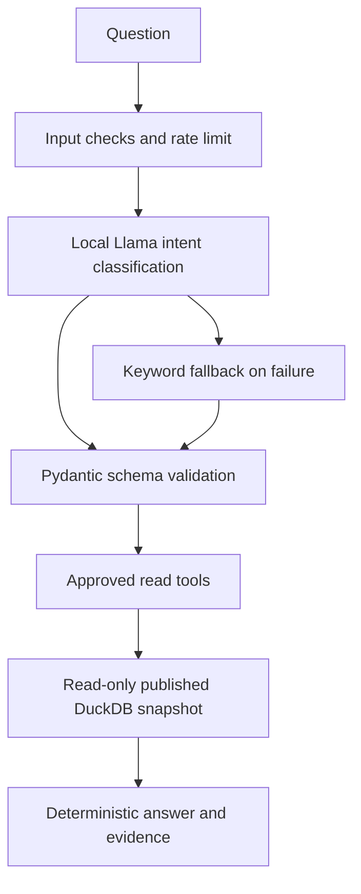

# Ask Fleet Pulse — local Meta Llama analytics

Version 0.2.0 adds a chat panel to the existing dashboard. Meta (formerly Facebook)
Llama 3.2 3B runs locally through Ollama, without a paid LLM API. Model weights have
their own Meta license and acceptable-use terms; this repository's MIT license
covers the application code, not the model weights.

## Windows PowerShell quick start

Install Python 3.12, Java 17 and Ollama from https://ollama.com/download/windows.
Open Ollama and run the following. Pulling the model needs internet and disk space;
inference runs locally. CPU speed and available RAM affect response time.

```powershell
ollama pull llama3.2:3b
ollama run llama3.2:3b "Reply with hello"
```

If the local Ollama service is not running, use `ollama serve` in a separate terminal.
Do not start a second service when the Ollama desktop application already runs it.

From the repository root:

```powershell
py -3.12 -m venv .venv
.\.venv\Scripts\python.exe -m pip install -r requirements.lock
.\.venv\Scripts\python.exe -m pip install --no-deps --no-build-isolation -e .
$env:OLLAMA_BASE_URL = "http://localhost:11434"
$env:OLLAMA_MODEL = "llama3.2:3b"
$env:SPARK_LOCAL_IP = "127.0.0.1"
# Skip these two commands if a published local snapshot already exists.
.\.venv\Scripts\fleet.exe generate
.\.venv\Scripts\fleet.exe run
.\.venv\Scripts\python.exe -m uvicorn fleet.api:app --host 127.0.0.1 --port 8000
```

Visit http://localhost:8000 and select **Ask Fleet Pulse**. The `.env.example` file
is documentation; this application reads shell environment variables and does not
automatically load `.env`. See the main README for Spark/Java troubleshooting.

## Docker Compose (optional)

```sh
docker compose --profile tools run --rm pipeline
docker compose --profile copilot up -d ollama
docker compose exec ollama ollama pull llama3.2:3b
docker compose --profile copilot up -d --build dashboard
```

Ollama is accessible only inside the Compose network; no host port is published.
The dashboard points to `http://ollama:11434` in Docker, not host localhost.
The optional Ollama image uses `latest` for local convenience; pin a tested digest
before deployment. No GPU configuration is required, but CPU inference can be slow.
These Compose commands are provided but were not executed in the build environment.

## Questions you can ask

- Summarize the fleet in Austin.
- Top vehicles by energy.
- Which vehicles have the most alerts?
- Compare fleet regions.
- Show trips for EV-008.
- How many records failed validation?

Rankings return up to five vehicles in descending order. Energy is kWh, distance is
km, costs are recorded USD, and efficiency is distance-weighted kWh/100 km (higher
means less efficient). Trip lookup returns up to ten recent trips. Comparisons show
all published regions even when the question names two; the answer labels this.
Quality counts cover the entire snapshot. The dashboard's region selector does not
implicitly filter chat: name the region in the question. Follow-up context and
custom date filters are not supported. All results identify the full date range.

## Trust boundary



The model receives the question and a fixed tool schema, not database contents.
It cannot output SQL, shell commands, HTML, database paths or a destination URL.
Only the application owns query templates, metric expressions and model endpoint
configuration. User-specified vehicle and region filters are parameterized.
Numerical answers are rendered from tool output; no model-generated prose is
presented as evidence. This prevents fabricated numerical summaries, but does not
prove intent accuracy: Llama can still select the wrong allowed tool. The response
shows the selected scope; clarify the question if that happens.

Common unsafe/write, prediction, date-filter and diagnostic questions are refused.
Keyword checks are a usability layer, not the security boundary. Even if bypassed,
all available tools remain read-only and bounded. Arbitrary SQL is never accepted.
No private data, real locations, credentials, user authentication or write actions
are implemented. Bind to localhost; deploy behind authentication and a shared rate
limiter before exposing to other users. Limits are 20 chat requests/minute across
one application process, not per-user across workers. CORS is not enabled.

Ollama has a 2-second connection timeout and 25-second read timeout; transient
connection/read errors get one retry. Invalid schema, HTTP errors and timeouts
fall back to a limited keyword router. Fallback mode is visible on every answer.
A missing or failed serving snapshot returns a friendly 503 rather than invented
numbers. Chat messages are not persisted or included in application request logs.
Ollama itself is a separate process with its own data-handling settings. The UI
keeps messages only in page memory until reload. Each question is independent.

## API

`POST /api/chat`, JSON body (3–1000 characters):

```json
{"message": "Top vehicles by energy"}
```

The response includes `answer`, `data`, `intent`, `mode` (`llama`, `fallback`, or
`guardrail`), `notice`, `sources`, `run_id`, `period`, `request_id`, and `synthetic`.
The request ID also appears in the `X-Request-ID` header. Inspect `/docs` for the
full typed schema. Invalid input returns 422; exhausted demo budget returns 429
with Retry-After; no serving data returns 503.

## Evaluation and limitations

Run `python -m pytest -q` and `python -m ruff check .`.
Tests use an isolated synthetic DuckDB fixture and mock Ollama transport. They
cover structured output, invalid schemas, timeouts, retries, exact numerical tool
results, scope evidence, unknown vehicles, prompt-injection examples, unavailable
data, input limits and rate limiting. No CI model download is required.

Live Llama inference has not been evaluated in this build environment. The mocked
integration proves request/response handling, not the model's semantic accuracy.
Before demonstrating Llama, pull the model and verify the `LOCAL LLAMA` badge for
the six example questions above. Compare every numerical result to the dashboard.
Do not present fallback screenshots as proof of live Llama inference.

Official references: https://docs.ollama.com/capabilities/structured-outputs,
https://docs.ollama.com/api/chat, https://ollama.com/library/llama3.2:3b.

### Observed validation for this update

- Final API/unit run: **41 passed, 4 Spark cases deselected** (JUnit:
  `reports/copilot-tests.xml`).
- The four Spark integration cases passed in the preceding full-suite run. That
  run exposed a guardrail regex bug, which was fixed and verified by the final
  API/unit run. The Spark pipeline code was not changed.
- Ruff lint and formatting: passed. Python v0.2.0 wheel build: passed.
- Browser: desktop 1440×1000 and mobile 390×844; real published dataset, five-row
  ranking, evidence metadata, labelled fallback, safety reply, close interaction,
  no page-level JavaScript errors or horizontal document overflow.
- Remaining external verification: live Ollama/Llama semantic accuracy and the
  optional Compose deployment. GitHub CI/release must be run after upload.
